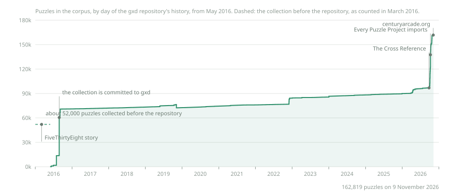

# History

Counted from the git repository's history by `corpus-stats.py`; the chart is drawn from that count by [`scripts/history-chart.py`](https://github.com/century-arcade/xd/blob/master/scripts/history-chart.py).

The xd Crossword Corpus was created by [Saul Pwanson](https://saul.pw/) in 2016. He promptly uncovered a [plagiarism scandal](https://web.archive.org/web/20161026053530/https://fivethirtyeight.com/features/a-plagiarism-scandal-is-unfolding-in-the-crossword-world/#fn-1). With that attention came contributions from other collectors, and the corpus grew rapidly to nearly 90,000 puzzles.

Much changed in the ensuing decade: major outlets [abandoned](https://www.nytimes.com/2021/08/02/crosswords/nyt-games-no-longer-available-on-across-lite-as-of-aug-9.html) simple `.puz` file downloads in favor of xml, json, or their own formats, many more self-published outlets arose, web- and mobile-native puzzle syndicates formed, mobile apps became a major channel for solving, and variants such as the mini and midi gained traction.

In 2026 several new volunteers joined the team, and together grew the corpus from ~90,000 puzzles to over 160,000 and counting. In October 2026, Saul handed off maintenance duties to [Alex Dejarnatt](https://alexdej.com/), an independent software developer and crossword enthusiast. The team's focus today is on establishing guidelines for the proper archival of crosswords, including the [`xd` file format](https://github.com/century-arcade/xdformat). The project continues to accept [contributions](./CONTRIBUTING.md) and publish [datasets](./DATASETS.md) for non-commercial use.