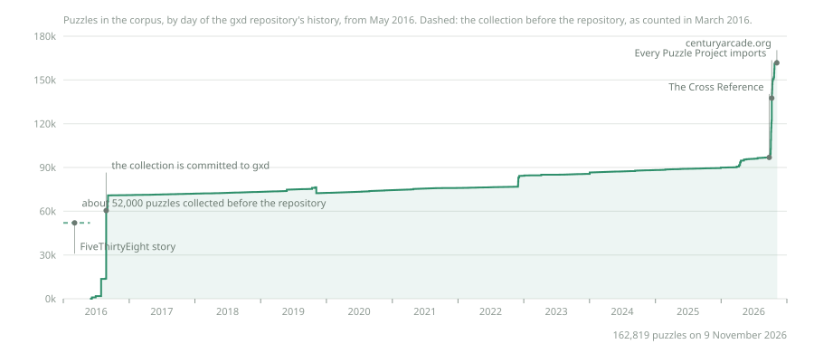

# History

Counted from the git repository's history by `corpus-stats.py`; the chart is drawn from that count by [`scripts/history-chart.py`](https://github.com/century-arcade/xd/blob/master/scripts/history-chart.py).
